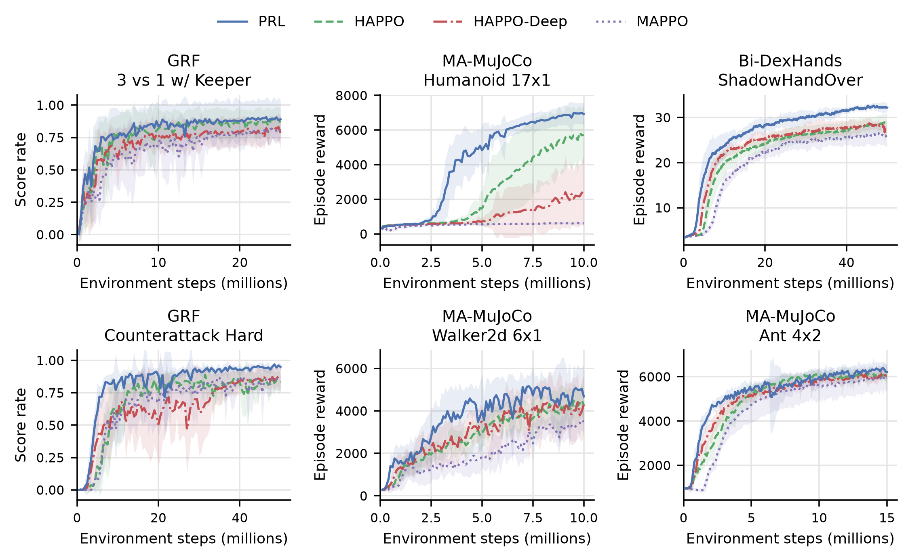

# Critic-Guided Predictive Representations for Policy-Gradient Multi-Agent Reinforcement Learning

**Zesheng Hong, Xinren Zhang, Jiadong Yu, Pan Hui**

Centralized training with decentralized execution (CTDE) is a standard paradigm for cooperative multi-agent reinforcement learning. Although policy-gradient CTDE methods excel at cooperative multi-agent tasks by avoiding restrictive value-factorization constraints, they inherently suffer from a fundamental representation bottleneck: while centralized critics learn rich global representations, this knowledge is transmitted to decentralized actors solely through scalar advantage signals---a narrow feedback channel that provides insufficient supervision for actors to infer decision-relevant global structures from partial observations. We propose Predictive Representation Learning (PRL), which utilizes the centralized critic as a training-time representation teacher to improve decentralized actor representations. PRL trains decentralized actors to additionally predict the critic-side embedding of the next global state, while preserving decentralized execution at test time. Importantly, it can be plugged into a range of policy-gradient CTDE algorithms with minimal modification. Empirical results show that PRL consistently outperforms strong policy-gradient CTDE baselines and depth-matched variants across cooperative multi-agent tasks spanning Google Research Football, Multi-Agent MuJoCo, and Bi-DexterousHands. Target-choice ablations and representation probing further show that the next critic embedding provides an effective supervision signal for learning richer decentralized actor representations.

## Paper and implementation

- [Training and environment setup](docs/reproducibility.md).

PRL minimizes a policy-gradient objective plus an auxiliary coefficient times masked prediction MSE. Target normalization is task-specific; exact settings are in the released configurations. HAPPO-Deep uses the same deep residual actor backbone without the auxiliary head/loss. MAPPO-PRL uses the predictive objective with MAPPO updates.

The implemented target controls are **current critic latent** and **joint action** prediction. The latter includes the agent's own action. Earlier labels `Pred_Current_State` and `Pred_Teammate_Action` are retained in configuration names; they do not mean raw-state reconstruction or an exclusively teammate-action target. Post-training probes separately decode global state, teammate actions, and the next critic latent.

## Results

The expanded comparison uses **10 matched seeds per task and method**. Final-10 is the per-run mean of the last ten logged checkpoints. GRF uses score rate; MuJoCo uses evaluation return; Bi-DexHands uses training-rollout reward. Error bars in learning curves are standard deviations, not confidence intervals.

| Task | PRL − HAPPO-Deep, Final-10 | Paired BCa 95% CI | Holm p | Wins |
|---|---:|---:|---:|---:|
| GRF 3-vs-1 | +8.97 pp | [−3.01, 17.20] | .2383 | 9/10 |
| GRF Counterattack | +9.00 pp | [4.53, 13.51] | .0313 | 9/10 |
| Ant 4×2 | +272.9 | [120.4, 398.4] | .0352 | 8/10 |
| Humanoid 17×1 | +4682.8 | [2956.4, 5727.2] | .0195 | 9/10 |
| Walker2d 6×1 | +704.1 | [−99.5, 1498.7] | .2383 | 7/10 |
| ShadowHandOver | +4.51 | [3.42, 5.60] | .0117 | 10/10 |

Four of six Final-10 comparisons and five of six normalized-AUC comparisons against HAPPO-Deep survive Holm correction. The GRF 3-vs-1 and Walker2d Final-10 differences remain suggestive. Across this fixed six-task suite, PRL wins 52/60 matched pairs against HAPPO-Deep. This evidence does not guarantee improvements on unseen tasks or exact global-state recovery.

Five-seed wall-clock measurements show a mean task-wise overhead of 7.6% against HAPPO-Deep (range 1.97–19.76%). At equal observed wall-clock cutoffs, PRL has higher means on all six tasks against HAPPO-Deep, but on four of six against the smaller HAPPO actors. Three-seed coefficient sweeps and stability analyses are included in the paper; some continuous-control tasks show larger mid-training downward fluctuations.



## Quick start

Use Linux and the benchmark-specific simulator dependencies described in [the reproduction guide](docs/reproducibility.md). Install PyTorch for your CUDA version before installing the project:

```bash
python -m pip install -e .
python scripts/train_paper.py --list
```

The launcher selects the saved paper configuration and exposes task, method, and seed explicitly. Inspect a configuration before starting a full run:

```bash
python scripts/train_paper.py --task grf_3v1 --method prl --seed 1 --dry-run
python scripts/train_paper.py --task grf_3v1 --method prl --seed 1
```

Use seeds 1–10 for the expanded main comparison and the same seeds for each baseline. Full experiments require hours per run; installing this repository does not install proprietary simulator components. The guide lists task identifiers, evaluation metrics, budgets, ablations, and tests.

## Repository layout

```text
harl/                  actor–critic training, buffers, environments
tuned_configs/         task and method configurations
scripts/               paper experiment launcher and validation
docs/                  installation and reproduction details
```

## Citation

```bibtex
@misc{hong2026criticguided,
  title={Critic-Guided Predictive Representations for Policy-Gradient Multi-Agent Reinforcement Learning},
  author={Hong, Zesheng and Zhang, Xinren and Yu, Jiadong and Hui, Pan},
  year={2026},
  note={Preprint},
  url={https://github.com/Rocky18919975029/HARL_PRL}
}
```

An arXiv identifier will be added after submission. Please also cite [HARL](https://jmlr.org/papers/v25/23-0488.html) and the benchmarks used in your experiments. Code attribution and licensing are preserved in [LICENSE](LICENSE); bundled third-party components retain their own notices.
